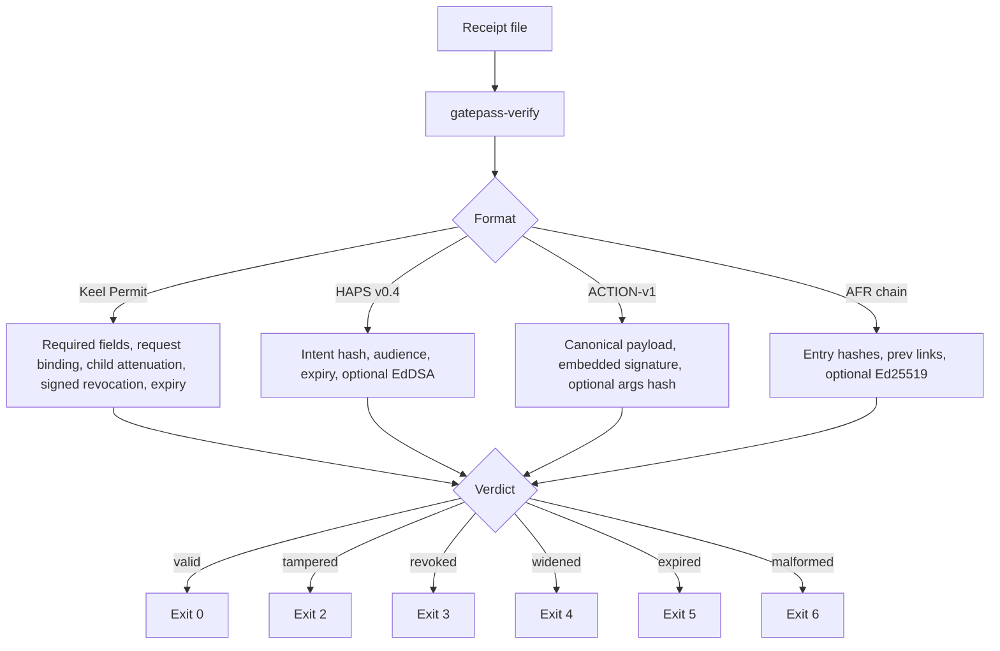

# gatepass-verify

Offline checks for authorization receipts. One file in, one verdict per record.

```bash
npx gatepass-verify fixtures/keel/narrow.json --now 2026-06-01T00:00:00Z
```

The command does not use the network. It reads the file you pass and prints a verdict.

## Why

An authorization receipt is only useful if anyone can check it later, without sending the file to the issuer. gatepass-verify reads one local file, detects the format or honors `--format`, and prints one verdict per record.

A Keel child permit that is broader than its parent is `widened`. A broken hash, signature, or argument binding is `tampered`. A signed `permit.revoked` event that covers a permit or its parent is `revoked`. A record past its expiry at the verification clock is `expired`. Input this tool cannot parse, or a format it does not implement, is `malformed`. The process exits 0 only when every record is `valid`. Other verdicts exit 2 through 6, in the order listed under Exit codes. A rejected file exits 1.

This package is a neutral verifier for the four published formats below. It does not yet verify GatePass Decision Records. Support for that format is planned for a later release.



## Verdicts

| Code | Label | Meaning |
| --- | --- | --- |
| `valid` | Valid | Every check that was run passed. |
| `tampered` | Tampered | A hash, signature, or argument binding does not match. |
| `revoked` | Revoked | A signed revocation covers this record or its parent. |
| `widened` | Widened beyond mandate | A child authority is broader than its parent. |
| `expired` | Expired | The record is past its expiry at the verification clock. |
| `malformed` | Malformed | The input is unreadable, incomplete, or a format this tool does not implement. Unsupported input fails closed here. |

`ok` in the JSON result is true only when every record is `valid`.

## Exit codes

| Code | When |
| --- | --- |
| 0 | Every record is valid. |
| 1 | The file was rejected before verification (missing file, bad flag, empty input, or over the 1 MiB limit). |
| 2 | A record is tampered. |
| 3 | A record is revoked. |
| 4 | A record is widened beyond mandate. |
| 5 | A record is expired. |
| 6 | A record is malformed, or the format is unsupported. |

When several records fail, the exit code is the first match in this order: tampered, widened, revoked, expired, malformed.

## Formats

Interop below is experimental and implemented from the public spec. It is not a certification, and it is not a claim that a receipt was produced by the reference issuer.

| Format | Flag | Public source | What is checked | What is not checked |
| --- | --- | --- | --- | --- |
| Keel Permit | `keel-permit` | [draft-munoz-scitt-permit-profile-01](https://datatracker.ietf.org/doc/html/draft-munoz-scitt-permit-profile-01), [keel-permit](https://github.com/keelapi/keel-permit) comparator `authority-envelope.v0` | Permit v1 required fields. `binding_request_hash` against the supplied request bytes, after the published volatile-key and credential-key strip, using code-point canonical JSON. Child authority is equal to or narrower than the parent on the v0 set fields (`actions`, `tools`, `providers`, `models`, `data_classes`, `regions`) and `expires_at`. A wider child is `widened`. A signed `permit.revoked` event, Ed25519 over the hex SHA-256 of the canonical event, revokes that permit and its children. Expiry uses `--now` or the local clock. | COSE_Sign1. The permit object itself is not signed: permit v1 reserves `signature`. Linked-chain receipts, closure records, and transparency-log checkpoints. Comparator `work-action-authority.v2` and any envelope version other than `authority-envelope.v0`. Policy evaluation. The draft's illustrative hashes are not test vectors. |
| HAPS | `haps` | [iProov/HAPS](https://github.com/iProov/HAPS) experimental v0.4 | `intent_hash` over the supplied action intent (RFC 8785, SHA-256, base64url, `sha256:` prefix). The same check for `presentation_hash` when a signing view is supplied. `jti` is present. `aud` is present, and must match `--aud` when you pass it. `exp` against the verification clock. A changed action is `tampered`. An EdDSA compact JWS is checked only when you supply a public key. | Provider identity, biometric or liveness evidence, assurance policy, and single-use replay. Those need a provider, a factor, and stored `jti` state. No key means the provider signature is skipped and the result says so. Passing the hash does not show what a person saw. |
| ACTION-v1 | `action-v1` | [ACTION-v1](https://github.com/Aqta-ai/attestation-spec/blob/main/spec/ACTION-v1.md), [aqta.ai/action-v1](https://aqta.ai/action-v1) | Field set, `outcome` of `ALLOWED` or `BLOCKED`, hash shape, UTF-16 policy order, timestamp offset, and the Ed25519 signature over the canonical payload using the embedded public key. When `args` is supplied, `args_hash` is recomputed. `--key action-v1=<path>` pins that key. | Whether the action ran. The `agent` string is caller-asserted. Without a pin, a passing signature only shows that the embedded key signed the bytes. The published vectors do not include argument preimages, so those files skip the preimage check. |
| agent-flight-recorder | `afr` | [multiagent-flight-recorder](https://pypi.org/project/multiagent-flight-recorder/), [source](https://github.com/Mihirajmera/agent-flight-recorder) | Each JSONL entry's sequence, `prev` link, and SHA-256 over the canonical entry with `hash` and `sig` removed. Ed25519 signatures when `--key afr=<path>` is set. A hash or link break is `tampered`, and every later entry is `tampered`. A signed entry with no key is `malformed`. | Policy decisions, approval expiry, and OSCAL output. Truncation of a valid tail is not visible unless you keep the head elsewhere. This tool does not take an anchor. |

Pass `--format` to force one parser. The default detects the format and refuses input it does not recognize.

## JSON result

`--json` prints schema `gatepass-verify.result.v1` (version 1). The schema file is [`schema/result.v1.json`](schema/result.v1.json).

```json
{
  "schema": "gatepass-verify.result.v1",
  "version": 1,
  "ok": true,
  "records": [
    {
      "index": 0,
      "id": "22222222-2222-4222-8222-222222222222",
      "format": "keel-permit",
      "verdict": "valid",
      "label": "Valid",
      "checks": [
        { "name": "binding_request_hash", "ok": true, "detail": "request bytes match binding_request_hash" }
      ],
      "summary": "Permit decision allow passed the checks that were supplied."
    }
  ]
}
```

`checks[].ok` is `true`, `false`, or `null`. `null` means the check was skipped because the evidence was not supplied. A skip is not a pass.

## Library

```ts
import { verify, type VerifyResult } from "gatepass-verify";

const result: VerifyResult = verify(bytes, {
  now: new Date("2026-06-01T00:00:00Z"),
});
```

`verify` takes file contents, not a path. It does not read the filesystem or open a network connection.

## Fixtures

`fixtures/expected.json` is the file-to-verdict list the tests run.

Keel attenuation files in `fixtures/keel/` were built for this verifier from the public permit v1 and `authority-envelope.v0` rules. They are not Keel-published test vectors. The signing key is derived from a public string and is written into those files. Do not use it for a real record.

HAPS files under `fixtures/haps/published/` are the v0.4 canonicalization vectors from iProov/HAPS. `fixtures/haps/valid.json` wraps the published payment claims and action intent.

ACTION-v1 files under `fixtures/action/published/` are vectors from Aqta-ai/attestation-spec. `args-match.json` and `args-mismatch.json` are signed by the fixture key so the argument preimage can be checked.

`fixtures/afr/published/flight.jsonl` and `flight-tampered.jsonl` are the sample log published with agent-flight-recorder, checked with the public key published beside that log.

## Limits

- Input over 1 MiB is rejected and the process exits 1.
- The verifier fails closed on unparseable input, unknown formats, missing parents, unknown envelope fields, and revocation events that do not verify.
- There is no clock inside a receipt. Pass `--now` when you want a reproducible expiry check. The default clock is the machine clock.
- Node.js 20 or newer.

## Development

```bash
npm ci
npm test
npm pack --dry-run
npm run smoke
```

`npm test` typechecks through the build, then runs the unit tests. `npm run smoke` packs a tarball, installs it in a clean directory, and runs the installed command against every fixture.

## Maintainer

Swapnil Rajkumar Gaikwad (Neil). Report a verification bypass to security@usegatepass.com.
